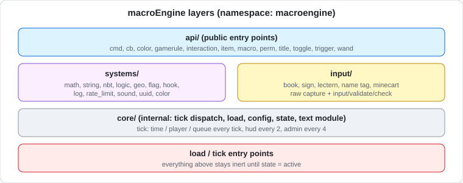

# macroEngine (v26.3)

**macroEngine** is a macro/module framework datapack for Minecraft Java Edition, providing a large library of reusable command-based systems (math, string, NBT, geo, permissions, UUID cache, hooks, rate limiting, and more) plus a multi-source text/value input system (books, signs, lecterns, name tags, command block minecarts).

> **Project history:** originally developed under the `runtoolkit` organization (`runtoolkit/suite`), later moved to `vortacraftmc`. Both organizations are now archived — kept online and publicly visible, never deleted, but no longer maintained. Active development moved to **VortaForge** (`vortaforge/core`), where this pack is actively maintained; nothing in this history was deleted or hidden.
>
> Minecraft: **26.3** (`min_format` / `max_format` **121.0**)
>
> License: Unlicense (third-party components listed in [`THIRD_PARTY_LICENSES.md`](THIRD_PARTY_LICENSES.md))
>
> Namespace: `macroengine`
>
> AI disclosure: portions of this pack's code, documentation and refactoring were produced with AI assistance. This is stated explicitly rather than left to the commit author field — see [`CREDITS.md`](../../CREDITS.md) if present, or the repository's AI-disclosure notes. This is not a statement that every line was AI-written, only that AI assistance was used in this project's development and is not being concealed.

---

## Features



- **API layer** (`api/`) — stable public entry points: `cmd`, `cb` (callback queue), `color`, `gamerule`, `interaction`, `item`, `macro`, `perm`, `store`, `title`, `toggle`, `trigger`, `wand`, plus `block` (custom block entity interface) and `container` (slot and inventory helpers)
- **Systems layer** (`systems/`) — internal utility modules: `math`, `string`, `nbt`, `logic`, `geo`, `flag`, `hook`, `log`, `rate_limit`, `sound`, `uuid`, `color`
- **Input system** (`input/`) — capture player-provided values via writable book, sign, lectern, name tag, or command block minecart, with shared validation (`input/validate`) for int/float/bool/tag-safe strings
- **Toggle system** — per-module runtime enable/disable for `cb`, `perm`, `geo`, `wand`, `interaction`, `hook`, `block`, and `container` modules (`block` and `container` are the two load gates of the new API: `function macroengine:api/toggle/<module>/false` closes one)
- **Rate limiting** — global, per-player, and per-channel request throttling
- **Hook system** — bind functions to fire on events such as block break, dimension change, and advancement grant
- **Item modifiers** (`item_modifier/`) — reusable `item_modifier` definitions for enchanting, glint, lore, tooltip, and rename operations
- **Advancement-driven triggers** (`advancement/`) — core, hidden, and system advancements used to drive internal logic and hooks
- **Command conditions and nested groups** (`api/cmd/other/multi_cmd/`) — queue entries accept a `condition` object with boolean composition (`all_of`, `any_of`, `not`, nestable to depth 8) and a `commands` list that expands in place, so a group can be gated as a unit. Leaves: `tag`, `score` (target and bounds now optional), `predicate`, `entity`, `storage` (existence), and `data` (numeric range). Every leaf fails closed — a missing required key or an unreadable path reports *not passed* rather than silently passing
- **Deterministic RNG** (`systems/rng/`) — `seed`, `state`, `next`, `int`, `chance`, `pick`. Seeding makes randomised behaviour reproducible, which the previous generator could not do: it kept an undocumented `_rng_state` key with no way to set it. `systems/math/random` is now a thin wrapper over `systems/rng/int`, so there is one generator rather than two
- **Text-component rendering** (`systems/text/`) — helpers for NBT-backed components. On 26.1+ a `{"storage":...,"nbt":...}` component renders a string *with its quotes* and a number or boolean *with vanilla colouring* unless `interpret` and `plain` are both set. Every such component in this pack now sets both explicitly; `scripts/fix_text_components.py` at the repository root enforces it

- **Store module** (`api/store/`) — storage-based variables, per-player values, raw NBT helpers (`api/store/nbt/*`: `get`, `set`, `set_default`, `append`, `merge`, `remove`, `exists`, `count`, `copy`, `add`, `toggle`, `pop`, `shift` over any storage/path) and multilingual message templates (`render`, `render_all`, `convert`, `show`) that return plain strings; see [`README.md#macro-reference-store`](#macro-reference-store). It replaced the old `api/data` and `api/placeholder` modules. The documented store rendering path uses storage rather than embedding input into command strings; review trust boundaries and test integrations before treating untrusted input as safe. Migration notes: [`README.md#macro-reference-migrating-from-data-api`](#macro-reference-migrating-from-data-api)
- **Title / action bar with tokens** (`api/title/*_p`, plus `clear`, `reset`, `times`; see [`README.md#macro-reference-title`](#macro-reference-title)) — storage-driven (no quote/backslash breakage), rendered with `api/store/render` per recipient
- **Text UI** (`tui/`) — `line`, `header`, `divider` and `button` print formatted lines and clickable function buttons to the executor from storage (no text is pasted into a command); see [`README.md#macro-reference-tui`](#macro-reference-tui)
- **Cross-pack use** — [`README.md#macro-reference-interop`](#macro-reference-interop): how to detect macroEngine from another pack, which function tags other packs can extend, which storage to use, and the known conflicts between packs in this repository
- **Runtime config** (`core/config/*`, see [`README.md#macro-reference-config`](#macro-reference-config)) — every behaviour knob is a validated key: module on/off switches, tick systems and rates, handler scan intervals, queue depth, template limits and token switches, title defaults, name length

---

## Requirements

- Minecraft Java Edition **26.3**
- Datapack `min_format`/`max_format`: **121**

---

## Installation

macroEngine is a datapack: it ships as a folder (or zip) that goes into a world's `datapacks/` directory. There is no separate "installer" — the steps below just cover different ways of getting the folder there and reloading it, for different setups.

### Singleplayer / any OS (manual, UI-based)

1. Download or clone this pack so you have the `macroEngine-Datapack-v26.3` folder (or a zip of it).
2. Open your world's folder and go into `datapacks/`. In the Minecraft world-select screen this is reachable via **Edit → Open World Folder**.
3. Copy the `macroEngine-Datapack-v26.3` folder in (or the zip — Minecraft can load zipped datapacks directly, no need to extract).
4. Load the world (or if already in it, run `/reload`), then run `/datapack list enabled` to confirm `macroengine` is listed.

### Linux / macOS (Bash)

```bash
# Run from the repository root
WORLD_DIR="$HOME/.minecraft/saves/YourWorldName"   # adjust to your world path
cp -r packs/macroEngine-Datapack-v26.3 "$WORLD_DIR/datapacks/"
```

For a dedicated server (any Linux distribution — Debian/Ubuntu, Fedora/RHEL, Arch, etc. — the steps are identical, since this only touches the world save, not the OS):

```bash
SERVER_WORLD_DIR="/path/to/server/world"
cp -r packs/macroEngine-Datapack-v26.3 "$SERVER_WORLD_DIR/datapacks/"
# Then, from the server console or an operator in-game:
#   /reload
```

### Windows (PowerShell)

```powershell
# Run from the repository root
$WorldDir = "$env:APPDATA\.minecraft\saves\YourWorldName"   # adjust to your world path
Copy-Item -Recurse -Path "packs\macroEngine-Datapack-v26.3" -Destination "$WorldDir\datapacks\"
```

For a Windows-hosted dedicated server, replace `$WorldDir` with the server's world directory and run `/reload` from the console or in-game as an operator afterward.

### Server install, in general

1. Copy the pack folder into the **world's** `datapacks/` directory on the server (not the server's root directory — datapacks are per-world).
2. Run `/reload` as an operator, or restart the server.
3. Run `/datapack list enabled` to confirm `macroengine` loaded without errors; check the server log for any function errors on load.
4. macroEngine initializes automatically via `#macroengine:events/on_load` — no further setup commands are required for the base install.

### Installing via Claude Code (or another coding agent)

If you're scripting the install (e.g. provisioning a test server, or doing it as part of a larger Claude Code task), the operation is just a directory copy plus a `/reload`; there is no build step for the datapack itself. For example, ask Claude Code to:

> "Copy `packs/macroEngine-Datapack-v26.3` from this repo into `<world-path>/datapacks/`, then tell me the server needs a `/reload` or restart to pick it up."

Claude Code (or any agent) can safely automate the file copy; it cannot run `/reload` for you unless it has console/RCON access to the running server — that step still needs an operator.

To check the default tick configuration, see `data/macroengine/function/config/`.

---

## Usage

Most functionality is exposed through the `api/` namespace, e.g.:

```mcfunction
function macroengine:api/cmd/actionbar
function macroengine:api/perm/grant
function macroengine:api/wand/give
```

Internal systems under `systems/` are used by API functions and are not intended to be called directly by end users, though they remain accessible for advanced/custom integrations.

---

## Notes

- This is the 26.3 build of macroEngine, derived from the earlier build in the archived `runtoolkit/suite` monorepo (`packs/macroEngine-Datapack-v26.3`). Development continues in `vortaforge/core`; do not file issues or PRs against `runtoolkit/*`.

---

## FAQ

> This section is based on a **static review** of the source (the code was read, not run in-game). Test on a staging server before deploying to production.

### Is it safe?

**Short answer:** no malicious content was found, but it is not safe to install blindly either. It is a powerful toolkit and can be dangerous if misused.

- **What is not in the pack:** the zip contains no `.jar`, `.exe`, scripts, `.git/` or `.env` files, only datapack files (`.mcfunction`, `.json`, `pack.png`). A datapack cannot open network connections or write to the server's file system on its own.
- **The real risk is the command-executing APIs.** Several functions run a caller-supplied string as a command (the `$execute ... run $(cmd)` pattern: `api/cmd/as_player`, `api/cmd/other/run_*`, `api/perm/run`, `api/perm/exec`, `core/lib/queue_add_cmd`, `core/lib/schedule_cmd`). Passing player-controlled text (sign, book, name tag) into them results in **command injection**.
- **The input system does not execute input.** Captured raw text is only written to the `macroengine:input` storage. Validate it with `input/validate/check` (`int`, `float`, `bool`, `tag_safe`) before using it.
- **There is built-in protection, but it is a safeguard, not a sandbox.** Every non-empty `api/` function starts with the load gate (`#macroengine.open`) and the per-player consent gate; module functions also check their module switch (`api/toggle/*` and `api/diagnostics/*` do not, so they keep working when a module is off). Functions that run a command *string* (`api/cmd/as_player`, `api/cmd/other/run_*`, `api/perm/run`, `api/perm/exec`) do nothing unless an operator sets `dynamic_cmd` to `1b` (default `0b`). The stored-command features (queue, schedule, hooks, wands, trigger bindings, `multi_cmd`, `api/cmd/run_with_cb`) also require the `cmd.dynamic` permission and a command-root blocklist, see [`README.md#macro-reference-cmd-gate`](#macro-reference-cmd-gate). `api/perm/require` is enforced by default (`perm_enforce` `1b`); the per-wrapper permission `cmd.<name>` is off by default (`perm_cmd` `0b`), see [`README.md#macro-reference-perm`](#macro-reference-perm).
- **What the protection does not cover.** There is no isolation between datapacks: any other datapack in the same world can call these functions. The blocklist only inspects the command root, so it does not stop `execute ... run op @s`. The `$(invoke)` helpers in `systems/geo/*`, `player/inv/*` and `world/block_*` are outside the dynamic-command gate by design. A datapack is plain text, so anyone who can edit the pack can remove these checks.
- **Permission level:** everything runs at the server's function permission level.

### Can I install it on a server?

Yes. It is a purely server-side datapack, and players do not need any mods. Requirements:

1. **Version:** the pack targets `26.3` (pack format `121.0`).
2. **Text rendering:** use it together with `macroEngine-Resourcepack-v26.3`.
3. **Back up first** and try it on a test server.
4. **Removal:** delete the pack from the world's `datapacks` folder (Realms: re-upload the world without it). The pack no longer ships server-administration commands (`/datapack`, `/op`, ...).

### Is it paid?

No. macroEngine's original code is released under the **Unlicense** and may be used commercially. The pack also contains PlayerAction, which is licensed under MIT: keep its copyright and permission notice in copies or substantial portions. See [`THIRD_PARTY_LICENSES.md`](THIRD_PARTY_LICENSES.md). This is not legal advice.

### How is the performance?

Not measured. From the code: while players are online, the `time`, `player` and `queue` systems run **every tick**, `hud` every 2 ticks and `admin` every 4 ticks. `player_systems` also runs NBT-filtered `execute as @e` / `kill @e` scans over all `item` entities every tick, so cost grows with the number of dropped items. Systems you do not use can be turned off with `systems/flag/toggle_system`.

### Screenshots and demos

<!--
In-game media is not included yet. Add real captures under media/ and uncomment:


-->

The diagrams above are generated from the source code. Real in-game captures (input capture) are not available yet.

## Known Issues

- **Single target.** Minecraft Java 26.3 (data pack format `121.0`). Other versions are not tested and may not load.
- **Forceload side effects.** On load the pack runs `forceload add 0 0` and `forceload add -30000000 1600`. Cleanup only runs `forceload remove 0 0`, which also removes a `0 0` forceload the server owner added themselves, and `-30000000 1600` is **never removed** (if it lies outside the world border, the command may fail silently).
- **Command-string APIs are gated by a master switch, not by caller identity.** With `dynamic_cmd` on, `api/cmd/as_player`, `api/cmd/other/run_*` and `api/perm/run|exec` apply no command-root blocklist and no `cmd.dynamic` check, and the per-wrapper permission is off by default (`perm_cmd`). See "Is it safe?".
- **NBT-filtered `@e[type=item]` scan every tick** (performance note above).
- **Older archive contents may differ.** Verify that a particular archive contains `LICENSE` and `THIRD_PARTY_LICENSES.md` before redistributing it. The current source uses `_vc_origin.mcfunction`; the Gradle individual-pack ZIP strips it from a temporary copy, while `scripts/build_release.py` retains it.

## License

- macroEngine original code: Unlicense — see [`LICENSE`](LICENSE).
- PlayerAction: MIT, with copyright and license text in [`THIRD_PARTY_LICENSES.md`](THIRD_PARTY_LICENSES.md); retain that notice when redistributing the applicable code.
- String module (`core/lib/string`, `core/internal/text`): macroEngine original code.

Current individual-pack build paths include both license files; merged packs carry notices from their included source packs.


## Consolidated module and security references

These reference texts were moved from the former `docs/` directory. The architecture image is preserved under [`media/architecture.svg`](media/architecture.svg). Historical examples and behavior were not executed for this migration.


<a id="macro-reference-cb"></a>
<details>
<summary>cb.md</summary>

# api/cb — command-block callbacks

Run a command string through a temporary command block, now or later.

| Function | Input (`macroengine:input cb`) | Output |
|---|---|---|
| `api/cb/run` | `cmd`, optional `x` `y` `z` | — |
| `api/cb/run_delayed` | `cmd`, `delay` (ticks, min 1), optional `x` `y` `z` | `macroengine:output cb_id` |
| `api/cb/run_sequence` | `cmds` (list), optional `interval` (default 2), `x` `y` `z` | `macroengine:output cb_id` (one id for the whole sequence) |
| `api/cb/run_repeating` | `cmd`, `times` (1..100), optional `interval` (default 2, min 1), `x` `y` `z` | `macroengine:output cb_id` (one id for all runs) |
| `api/cb/time_left` | `id` | `macroengine:output cb_time_left` (ticks until the next entry of that id, -1 if none), `cb_pending` (entries still queued) |
| `api/cb/cancel_id` | `id` (the `cb_id` you got back) | `macroengine:output cb_cancelled` (entries removed, 0 if already fired) |
| `api/cb/cancel` | — | clears the whole queue |
| `api/cb/queue_size` | — | score `#cb_queue_size macroengine.tmp` |
| `api/cb/list` | — | prints the queue to the executor |

```mcfunction
data modify storage macroengine:input cb set value {cmds:["say one","say two","say three"],interval:20}
function macroengine:api/cb/run_sequence

# how long until the next step?
data modify storage macroengine:input cb.id set from storage macroengine:output cb_id
function macroengine:api/cb/time_left

# changed my mind: drop whatever has not fired yet
data modify storage macroengine:input cb.id set from storage macroengine:output cb_id
function macroengine:api/cb/cancel_id
```

Repeat one command (five runs, one second apart):

```mcfunction
data modify storage macroengine:input cb set value {cmd:"say tick",times:5,interval:20}
function macroengine:api/cb/run_repeating
```

## Behaviour notes

- **Quotes are fine in `cmd`.** The command is copied from storage into the block, not
  pasted into a macro line, so `say "hi"` works.
- **Fire spacing.** Entries share one temporary command block, and a second one placed
  too soon would overwrite the first before it ran. After an entry fires, anything else
  that is ready is pushed back by one tick, so fires are at least 2 ticks apart. A
  `run_sequence` with `interval:1` therefore runs at an effective interval of 2.
- **Ids.** `cb_id` is assigned by the engine (1, 2, 3 …) and compared as a number, so a
  caller-supplied value is never pasted into a command.
- The queue is cleared on `/reload`; ids restart with the next push.

</details>


<a id="macro-reference-cmd-gate"></a>
<details>
<summary>cmd_gate.md</summary>

# Dynamic command gate (`systems/cmd_gate/*`)

Every macroEngine feature that executes a command **string from storage**
(the work queue, schedule/once helpers, hooks, wands, trigger bindings,
`multi_cmd`, region watchers and both command-block runners) passes through
`macroengine:systems/cmd_gate/check` first. The `api/cmd/*` string runners and
`api/perm/run|exec` read the same master switch. Nothing in this category runs
until an operator turns it on.

Cross-pack overview and the full surface inventory:
`../../README.md#cross-pack-dynamic-command-gate` in the repository root.

## Enabling it

```mcfunction
# 1. Master switch (validated config path; survives /reload)
data modify storage macroengine:engine config_in set value {key:"dynamic_cmd",value:1b}
function macroengine:core/config/set

# 2a. Grant one player the permission directly
function macroengine:api/perm/grant {player:"Steve",perm:"cmd.dynamic"}

# 2b. ... or via a group (applies to present and future members on assign)
function macroengine:api/perm/group/create {group:"trusted"}
function macroengine:api/perm/group/grant_perm {group:"trusted",perm:"cmd.dynamic"}
function macroengine:api/perm/group/assign {player:"Steve",group:"trusted"}
function macroengine:api/perm/group/list
function macroengine:api/perm/group/remove {player:"Steve",group:"trusted"}
```

Groups are plain data in `macroengine:engine groups.<group>`: a list of
permission names, granted and revoked by admins only. Assign materialises the
list into the same `perm.<name>` tags `api/perm/require` has always checked,
plus a `group.<group>` membership tag, so no existing permission check in the
pack changes meaning. Adding a permission to a group affects a player the
next time the group is assigned to them.

Turning dynamic commands back off is the same config call with `value:0b`;
`macroengine:core/config/reset` also returns it to `0b`, like every other key.

## What the gate checks (in order, fail-closed)

1. `module_cmd` config is on.
2. `dynamic_cmd` config is `1b` (**default `0b`**).
3. The executor passes `api/perm/require` for `cmd.dynamic`
   (`macroengine.admin` or the `perm.cmd.dynamic` tag; a no-entity
   server/console/scheduled executor is trusted, the existing convention).
4. The string exists, is 1..`dynamic_cmd_max_len` characters (default 256),
   and contains no newline, carriage return or tab.
5. Its first token - the command root - is split off while the string is still
   data (string library, no macro substitution), checked free of quote and
   backslash, lower-cased, and compared against the blocklist.

A denial sets `macroengine:cmd_gate out {allowed:0b, error:"..."}` and returns
0; a blocklist hit also writes an audit entry (`cmd_gate.blocked`, detail =
the root). Callers use it exactly like `safe_name`:

```mcfunction
$data modify storage macroengine:cmd_gate in.cmd set value "$(cmd)"
execute unless function macroengine:systems/cmd_gate/check run return 0
$$(cmd)
```

## The blocklist

Defaults ship in `systems/cmd_gate/blocklist.mcfunction` and are meant to be
changed by editing that file in a pull request: `op`, `deop`, `stop`, `ban`,
`ban-ip`, `pardon`, `pardon-ip`, `kick`, `whitelist`, `save-off`, `reload`,
`datapack`, each also as `/name` and `minecraft:name`. They seed
`macroengine:engine cmd_blocklist` only when that key is missing, so an
operator may extend the list at runtime:

```mcfunction
data modify storage macroengine:engine cmd_blocklist append value "fill"
data remove storage macroengine:engine cmd_blocklist   # back to shipped defaults
```

The blocklist only sees the command root. It will not stop
`execute as @s run op @s`, because that command's root is `execute` - it is
defence in depth against accidents and against directly-stored dangerous
commands. The actual trust boundary is the default-off switch plus the
`cmd.dynamic` permission: grant it only to players you would also trust with
commands at `function-permission-level`.

## Limits worth knowing

- Macro-based executors capture their input with a quoted macro line
  (`set value "$(cmd)"`, as before this gate existed), so a stored command
  containing a double quote or backslash cannot traverse those paths at all
  and fails before the gate is reached. The command-block runners
  (`api/cmd/run_with_cb`, `api/cb`) copy from storage, and quoted commands
  keep working there - the gate normalises only the root token for them.
- Queued and scheduled commands execute later, usually with no entity as
  executor, which the permission step treats as trusted server context. Only
  datapack code (or an operator) can enqueue a command, and the master switch
  still applies at execution time.
- `systems/geo/*`, `player/inv/*` and `world/block_*` take an `$(invoke)`
  argument written by other pack code, not a stored string; they are
  intentionally outside this gate (see the root inventory).
- This is a safeguard inside a plain-text datapack, not a sandbox. It keeps
  player-triggered features from escalating into function-level commands by
  accident; it cannot stop someone who can edit the pack or who already has
  operator rights.

</details>


<a id="macro-reference-config"></a>
<details>
<summary>config.md</summary>

# Runtime config (`core/config/*`)

Every behaviour knob of the pack is a key in `macroengine:engine config`, created with its default by
`config.mcfunction`. **Every key below changes behaviour**: it is read by the code named in its row, not
just stored. Values are validated against a schema (`macroengine:engine config_schema`), so `core/config/set`
clamps numbers to the listed range and refuses unknown keys and unsafe strings.

```mcfunction
data modify storage macroengine:engine config_in set value {key:"hud_rate",value:5}
function macroengine:core/config/set          # validated, clamped, applied at once

data modify storage macroengine:engine config_in set value {key:"module_store",value:0b}
function macroengine:core/config/set          # switches the whole api/store module off

data modify storage macroengine:engine config_in set value {key:"hud_rate"}
function macroengine:core/config/get          # macroengine:output result
function macroengine:core/config/list         # prints everything to @s
function macroengine:core/config/reset        # defaults for every key
```

| Function | Input | Result |
|---|---|---|
| `core/config/set` | `config_in {key, value}` | applies; returns 1, or 0 for an unknown key, a bad value or an unsafe string |
| `core/config/get` | `config_in.key` | `macroengine:output result`; returns 1 / 0 |
| `core/config/apply` | none | copies the config to the scores and storage the engine reads |
| `core/config/reset` | none | restores every default and applies it |
| `core/config/list` | none | prints the config to `@s` |
| `core/config/ensure` | none | creates and applies missing keys; called every tick by `core/tick` (one revision check) |

## Modules

Public functions of a disabled module return 0 without doing anything. Tick scans of `hook`, `geo`, `interaction`, `wand` and `perm` stop too. A module that other modules call (`store` is used by `title`, `log` by many) makes its callers fail softly. `validate`, `toggle`, `flag` and `core/*` cannot be disabled: the safety checks and the config itself depend on them. The six modules that had `api/toggle/<name>/true|false` before (`cb`, `geo`, `hook`, `interaction`, `perm`, `wand`) keep those functions; they now write this config.

| Key | Type | Default | Range | Effect |
|---|---|---|---|---|
| `module_cb` | bool | `1b` | 0b / 1b | api/cb/*: 0b makes every public function return 0 |
| `module_cmd` | bool | `1b` | 0b / 1b | api/cmd/*: 0b makes every public function return 0 |
| `module_color` | bool | `1b` | 0b / 1b | api/color/*: 0b makes every public function return 0 |
| `module_gamerule` | bool | `1b` | 0b / 1b | api/gamerule/*: 0b makes every public function return 0 |
| `module_interaction` | bool | `1b` | 0b / 1b | api/interaction/*: 0b makes every public function return 0 |
| `module_item` | bool | `1b` | 0b / 1b | api/item/*: 0b makes every public function return 0 |
| `module_macro` | bool | `1b` | 0b / 1b | api/macro/*: 0b makes every public function return 0 |
| `module_perm` | bool | `1b` | 0b / 1b | api/perm/*: 0b makes every public function return 0 |
| `module_store` | bool | `1b` | 0b / 1b | api/store/*: 0b makes every public function return 0 |
| `module_title` | bool | `1b` | 0b / 1b | api/title/*: 0b makes every public function return 0 |
| `module_trigger` | bool | `1b` | 0b / 1b | api/trigger/*: 0b makes every public function return 0 |
| `module_wand` | bool | `1b` | 0b / 1b | api/wand/*: 0b makes every public function return 0 |
| `module_block` | bool | `1b` | 0b / 1b | api/block/*: 0b makes every public function return 0 (`api/toggle/block/true\|false` writes this key) |
| `module_container` | bool | `1b` | 0b / 1b | api/container/*: 0b makes every public function return 0 (`api/toggle/container/true\|false` writes this key) |
| `module_audit` | bool | `1b` | 0b / 1b | systems/audit/*: 0b makes every public function return 0 |
| `module_geo` | bool | `1b` | 0b / 1b | systems/geo/*: 0b makes every public function return 0 |
| `module_hook` | bool | `1b` | 0b / 1b | systems/hook/*: 0b makes every public function return 0 |
| `module_log` | bool | `1b` | 0b / 1b | systems/log/*: 0b makes every public function return 0 |
| `module_logic` | bool | `1b` | 0b / 1b | systems/logic/*: 0b makes every public function return 0 |
| `module_math` | bool | `1b` | 0b / 1b | systems/math/*: 0b makes every public function return 0 |
| `module_rate_limit` | bool | `1b` | 0b / 1b | systems/rate_limit/*: 0b makes every public function return 0 |
| `module_rng` | bool | `1b` | 0b / 1b | systems/rng/*: 0b makes every public function return 0 |
| `module_sound` | bool | `1b` | 0b / 1b | systems/sound/*: 0b makes every public function return 0 |
| `module_string` | bool | `1b` | 0b / 1b | systems/string/*: 0b makes every public function return 0 |
| `module_text` | bool | `1b` | 0b / 1b | systems/text/*: 0b makes every public function return 0 |
| `module_uuid` | bool | `1b` | 0b / 1b | systems/uuid/*: 0b makes every public function return 0 |

## Tick systems

`systems/flag/toggle_system {system:"hud"}` flips the matching key (the old version flipped a score twice and never changed anything).

| Key | Type | Default | Range | Effect |
|---|---|---|---|---|
| `sys_time` | bool | `1b` | 0b / 1b | tick system "time": epoch and tick counters |
| `sys_player` | bool | `1b` | 0b / 1b | tick system "player": trigger, interaction, perm, wand, hook and freeze scans |
| `sys_queue` | bool | `1b` | 0b / 1b | tick system "queue": work queue and cb queue |
| `sys_hud` | bool | `1b` | 0b / 1b | tick system "hud": HUD systems (progress bar) |
| `sys_admin` | bool | `1b` | 0b / 1b | tick system "admin": admin triggers and region watch |

## Tick rates

| Key | Type | Default | Range | Effect |
|---|---|---|---|---|
| `tick_rate` | int | `1` | 1 - 1200 | engine tick runs once every N game ticks |
| `hud_rate` | int | `2` | 1 - 1200 | hud systems run once every N engine ticks |
| `admin_rate` | int | `4` | 1 - 1200 | admin systems run once every N engine ticks |

## Handlers

`hook_interval` above 1 can miss edge events that are only visible for one tick (death/respawn and sneak start); wand clicks, interaction hits and score based hooks are kept until processed, so they are only delayed.

| Key | Type | Default | Range | Effect |
|---|---|---|---|---|
| `hook_interval` | int | `1` | 1 - 1200 | hook event scan runs once every N engine ticks |
| `geo_interval` | int | `1` | 1 - 1200 | region watch scan runs once every N engine ticks |
| `interaction_interval` | int | `1` | 1 - 1200 | interaction entity scan runs once every N engine ticks |
| `wand_interval` | int | `1` | 1 - 1200 | wand right-click scan runs once every N engine ticks |
| `perm_trigger_interval` | int | `1` | 1 - 1200 | perm trigger scan runs once every N engine ticks |
| `queue_max_depth` | int | `256` | 1 - 4096 | work queue entries processed per tick |

## Core

| Key | Type | Default | Range | Effect |
|---|---|---|---|---|
| `log_level` | int | `3` | 0 - 4 | 0 off, 1 error, 2 warn, 3 info, 4 debug |
| `reload_warn` | bool | `1b` | 0b / 1b | warn online players on /reload when data would be lost |
| `validate_max_name` | int | `64` | 8 - 256 | max length of names that go into macro lines (systems/validate/safe_name) |

## Store (templates)

`api/store/render` returns 0 when a template is longer than `store_max_template` or has more tokens than `store_max_tokens`. Disabled tokens are treated like unknown ones.

| Key | Type | Default | Range | Effect |
|---|---|---|---|---|
| `store_default_lang` | str | `"en_us"` | max 16 chars | last-resort language when a template is looked up |
| `store_max_template` | int | `8192` | 16 - 32767 | longest template (characters) api/store/render accepts |
| `store_max_tokens` | int | `128` | 1 - 1024 | most %tokens% one template may contain |
| `store_tok_score` | bool | `1b` | 0b / 1b | token enabled: %score:obj% |
| `store_tok_player` | bool | `1b` | 0b / 1b | token enabled: %player% and %name% |
| `store_tok_entity` | bool | `1b` | 0b / 1b | token enabled: %health% %food% %xp_level% %dimension% |
| `store_tok_global` | bool | `1b` | 0b / 1b | token enabled: %g:name% |
| `store_tok_pvar` | bool | `1b` | 0b / 1b | token enabled: %p:name% |
| `store_tok_args` | bool | `1b` | 0b / 1b | token enabled: %name% from in.args |
| `store_keep_unknown` | bool | `1b` | 0b / 1b | 1b keeps an unresolved %token% as written, 0b replaces it with nothing |

## Title

| Key | Type | Default | Range | Effect |
|---|---|---|---|---|
| `title_fade_in` | int | `10` | 0 - 1200 | default fade-in ticks for api/title/show_p |
| `title_stay` | int | `70` | 0 - 72000 | default stay ticks for api/title/show_p |
| `title_fade_out` | int | `20` | 0 - 1200 | default fade-out ticks for api/title/show_p |

## Dynamic commands (stored command strings)

Everything that macro-executes a command *string from storage* (the queue, hooks, wands, triggers,
`multi_cmd`, `once_cmd`, region watchers and the command-block runners) is gated by
`macroengine:systems/cmd_gate/check`; the `api/cmd/*` string runners read the same switch.
Full contract, blocklist and permission examples: [cmd_gate.md](#macro-reference-cmd-gate).

| Key | Type | Default | Range | Effect |
|---|---|---|---|---|
| `dynamic_cmd` | bool | `0b` | 0b / 1b | master switch for stored-string command execution; 0b makes every gated executor return 0 |
| `dynamic_cmd_max_len` | int | `256` | 1 - 4096 | longest command string the gate accepts |

## Permissions

Full description, switches and examples: [perm.md](#macro-reference-perm).

| Key | Type | Default | Range | Effect |
|---|---|---|---|---|
| `perm_enforce` | bool | value of `perm_default` (ships `1b`) | 0b / 1b | 0b makes `api/perm/require` and `api/perm/check` pass for everybody; `systems/cmd_gate` ignores this switch |
| `perm_cmd` | bool | `0b` | 0b / 1b | 1b makes every `api/cmd/<name>` wrapper also need the permission `cmd.<name>` (only while `perm_enforce` is 1b) |

`perm_default` is not part of `config` on purpose, so `core/config/reset` keeps it: it is the value
`perm_enforce` gets when it is created or reset (`api/toggle/perm/default_on|default_off`).

## Not configurable (on purpose)

- `systems/validate/safe_name` rules other than the length limit, and the macro-injection guards in `api/store`: turning them off would let untrusted text into commands.
- Runtime identifiers (`#vortacraftmc.*` fake players, `macroengine:*` storage names): renaming them breaks existing worlds.
- The `macroengine:engine security.multi_type_allowlist` field has no code that reads it, so it is not a config key.

</details>


<a id="macro-reference-container"></a>
<details>
<summary>container.md</summary>

# api/container — slot and inventory helpers

Works on container blocks at absolute coordinates. Input is read from `macroengine:input`
(`x`, `y`, `z`, plus `slot` / `slot2` / `tx ty tz` where noted); results go to
`macroengine:output container`. Numbers are checked as numbers before any macro line runs.
Close the module with `function macroengine:api/toggle/container/false`.

| Function | What it does |
|---|---|
| `api/container/info` | One-call summary: `{ok, size, used, free, empty, full, first_free}` |
| `api/container/is_empty` | Condition: no items at all |
| `api/container/is_full` | Condition: every slot occupied (optional `size` for unknown blocks) |
| `api/container/slot_get` | Reads one slot into `container.item` |
| `api/container/slot_set` / `slot_clear` / `slot_swap` | Writes, clears or swaps slots |
| `api/container/slot_is_empty` | Condition: one slot is empty |
| `api/container/transfer` | Hopper-like move of one stack into another container |

```mcfunction
data modify storage macroengine:input x set value 10
data modify storage macroengine:input y set value 64
data modify storage macroengine:input z set value -5
function macroengine:api/container/info
# macroengine:output container -> {ok:1b,size:27,used:3,free:24,empty:0b,full:0b,first_free:0}
```

`used` counts occupied slots, not items; a partly filled stack is one used slot. `first_free` is the
lowest empty slot, or `-1` when the container is full. A double chest reports one half (27 slots).

</details>


<a id="macro-reference-diagnostics"></a>
<details>
<summary>diagnostics.md</summary>

# Diagnostics

A read-only health check for the engine. It reads what the engine already stores (config, module flags, queue, log, audit) and reports problems as short codes. It does not repair anything.

```
function macroengine:api/diagnostics/report     # prints a report to the caller (macroengine.admin tag required)
function macroengine:api/diagnostics/status     # no output; returns the number of issues (0 = healthy)
function macroengine:systems/diagnostics/collect  # the collector both of them call
```

A player caller needs the `macroengine.admin` tag for `status` and `report`. A non-player caller (console, another datapack) may call `status` and `collect`. Every function starts with the usual gate and consent guard, so nothing runs while the pack is closed; use `gate/status` or `gate/report` to see why.

## Output

`macroengine:output diagnostics`:

| Key | Meaning |
| --- | --- |
| `ok` | `1b` when `issues` is empty |
| `issue_count`, `notice_count` | length of `issues` and `notices` |
| `issues` | problem codes (below) |
| `notices` | informational codes (below), not problems |
| `modules` | `{enabled, disabled}` counts |
| `queue` | `{size, cap}` |
| `audit` | `{count}` |
| `log` | `{level, buffered}` |

## Issue codes

| Code | Meaning |
| --- | --- |
| `config.missing`, `config.rev_missing`, `config.schema_missing` | the config, its revision marker or its schema is absent from `macroengine:engine` |
| `config.not_applied:<key>` | `core/config/apply` has not copied that key to the score the engine reads |
| `module.missing:<name>` | `modules.<name>` does not exist |
| `module.invalid:<name>` | `modules.<name>` is not `0b` or `1b` |
| `module.mismatch:<name>` | `modules.<name>` differs from `config.module_<name>` |
| `queue.over_cap` | the work queue is longer than `queue_max_depth` |
| `queue.not_draining:sys_queue_off` | the queue has entries but `sys_queue` is off |
| `engine.not_loaded` | `global.loaded` is not `1b` |

## Notices

`security.dynamic_cmd_enabled`, `tick.paused_storage`, `tick.paused_config`, `log.debug_level`, `audit.buffer_full` (100 entries, oldest are being dropped).

## What it does not do

- It does not measure CPU or tick time. It reports stored state, not performance.
- It does not count rate-limit denials or errors; the engine does not keep those counters.
- It does not fix anything. Use `core/config/set`, `core/config/apply` or a reload.
- The module list in `systems/diagnostics/checks/modules` must be kept in sync with `core/config/apply`.

It writes only its own output storage, scratch scores (`#macroengine.dg_*` in `macroengine.tmp`) and a scratch storage (`macroengine:diagnostics work`) that it removes before returning. This is based on a static read of the source; it has not been run in-game.

</details>


<a id="macro-reference-interop"></a>
<details>
<summary>interop.md</summary>

# Using macroEngine next to other packs

This page describes source inspection and historical static linting (originally
with Mecha; the current static checker is Spyglass). The old guikit datapack
is now retired. Nothing here was run in a Minecraft server.

## 1. Is macroEngine usable right now?

```mcfunction
execute if function macroengine:gate/is_open run function mypack:use_macroengine
```

`gate/is_open` reads one score (`#macroengine.open` in `vortaforge.gate`), prints nothing and returns 1 or 0. It has
no gate guard on purpose, so it can answer while the pack is closed (not approved, consent pending, incomplete or
reload-looping load).

`vortaforge.gate` is a shared objective: `RTWrapper-v1.0.1` creates it too,
as did historical `guikit-datapack` distributions, each with its own fake
players (`#macroengine.*`, ...). Read your own fake players; do not write to
another pack's.

## 2. Extension points (function tags)

Function tags merge across datapacks, so another pack can append entries to these. Remember that anything you add
runs at the permission level of the server (`function-permission-level`).

| Tag | Fired | Executor |
|---|---|---|
| `#macroengine:init` | once, at the end of the load chain (`core/internal/load/final`) | whoever ran the load chain (normally nobody) |
| `#macroengine:loop` | every tick | each online player (`execute as @a`, `core/tick`) |
| `#macroengine:admin/run` | every tick for players whose `macroengine_run` score is 1 or more | that player |
| `#macroengine:input/writable_book`, `/lectern`, `/sign`, `/name_tag`, `/anvil` | after text was captured into `macroengine:input` | see the capture function under `input/private/` |
| `#macroengine:input/command_block_minecart` | after a command block minecart capture | the minecart's owner, else the nearest player within 8 blocks |
| `#macroengine:events/on_death`, `on_respawn`, `on_join`, `on_enchant`, `on_jump` | from the matching bridge under `core/internal/systems/hook/` | the player |
| `#macroengine:events/on_lc`, `on_rc`, `on_open_gui`, `on_load` | tag files exist; look up the dispatch site with `grep -rn "events/on_lc" data` before relying on the executor | - |

There is no `#macroengine:events/on_tick`; use `#macroengine:loop`.

## 3. Storage

- Arguments go in `macroengine:input`, results come back in `macroengine:output` (the function header says which).
  `macroengine:input` is scratch space that macroEngine overwrites, so never keep your own data there.
- `uuid/*` results are in `macroengine:output uuid` / `uuid_array` since the 2026-10-28 change.
- Do not substitute text a player typed into a macro line. Validate with `input/validate/check` and pass it as a macro
  argument (see `README.md#macro-reference-store`).

## 4. Entities and tags macroEngine touches

macroEngine selects entities by its own tags (`macroengine.*`) and, in `core/internal/player`, by `player_action.*`.
A search for `kill`, `tp` and `data ... entity` on untagged `@e[type=...]` selectors found exactly one, in
`core/tick/player_systems`, and it only matches dropped items that carry macroEngine's own `custom_data`.
`api/interaction/remove` now also requires `macroengine.interaction`, so a tag you share with another pack's
interaction entities can no longer be removed through it.

`player/inv/chest_minecart_*` and `player/inv/transfer_item` match a `chest_minecart` within 2 blocks that carries a
tag you pass in. That is the hook for chest-minecart menus from other packs.

## 5. Known conflicts between packs

| Conflict | What happens | Status |
|---|---|---|
| `core/internal/player` uses un-namespaced `player_action.*` objectives, tags and interaction entities | Another pack that bundles the same names (for example the upstream PlayerAction library this code derives from) shares them: both packs read and clean up each other's state | **Open.** Phase 1 of `playeraction-rewrite-plan.md` renames them. It changes runtime identifiers stored in existing worlds, so it needs a migration plan and in-game testing first |
| Historical `guikit-datapack` distributions and `guikitfw` both use the namespace `guikit` | Enable only one; the merge manifest includes `guikitfw` | The old source is retired; `guikitfw` is the successor |

## 6. Merging with other packs

`packs/merge-manifest.json` drives `./gradlew mergeDatapacks`. Its `output.min_format` / `max_format` must match the
format of the included packs (`[121,0]` for 26.3), and every included pack needs a top-level `pack.mcmeta`.

</details>


<a id="macro-reference-migrating-from-data-api"></a>
<details>
<summary>migrating-from-data-api.md</summary>

# Moving from small "data API" style datapacks

macroEngine covers the helpers those packs usually provide, with the same macro-call style:

| Typical need | macroEngine |
|---|---|
| read / write / append / merge / remove NBT by `storage` + `path` | `api/store/nbt/get`, `set`, `set_default`, `append`, `merge`, `remove`, `exists`, `count`, `copy`, `add` (counters), `toggle` (flags), `pop` / `shift` (stack / queue) |
| placeholders in titles and action bars, message templates | `api/store/render`, `api/title/*_p` |
| run a command on a player / as a player | `api/cmd/*` |
| scheduled and delayed callbacks | `api/cb/*` |
| permissions, hooks, rate limits, RNG, math, string/text helpers | `api/perm`, `systems/*` |

Details: [store.md](#macro-reference-store), [title.md](#macro-reference-title), [config.md](#macro-reference-config).

Notes:

* This is a **concept mapping, not a drop-in shim**: function names differ from other packs.
  Check the pack you are leaving and map the calls one by one.
* `api/store/nbt/*` passes values through `macroengine:store nbt.value`, so no SNBT needs escaping:

```mcfunction
data modify storage macroengine:store nbt.value set value {hp:20,name:"Steve"}
function macroengine:api/store/nbt/set {storage:"mypack:data",path:"players.steve"}
function macroengine:api/store/nbt/get {storage:"mypack:data",path:"players.steve.hp"}
# -> macroengine:store nbt.result
```

* macroEngine has no load gate and never needs `op`, `allowCommands` or `level.dat` edits.
  Access control belongs to the server layer (Fabric), not to the datapack.

</details>


<a id="macro-reference-perm"></a>
<details>
<summary>perm.md</summary>

# Permissions: switches and per-command permissions

macroEngine's permission system is the `perm.<name>` tag system behind `api/perm/*`. A function that needs
a permission starts with `api/perm/require` (a player passes with the tag `macroengine.admin` or `perm.<name>`;
a server/console executor with no entity is trusted). This page covers the switches around it.

## Switches

| Switch | Function (run by a console/command-block executor or a player with the `macroengine.admin` tag) | Effect |
|---|---|---|
| enforcement | `api/toggle/perm/enforce_on` / `enforce_off` | off: `api/perm/require` and `api/perm/check` pass for everybody, nobody needs `/op` or a tag |
| default | `api/toggle/perm/default_on` / `default_off` | the value enforcement gets when `perm_enforce` is created or `core/config/reset` runs; does not change the current state |
| per-command | `api/toggle/perm/cmd_on` / `cmd_off` | on: each `api/cmd/<name>` wrapper needs the permission `cmd.<name>` (e.g. `cmd.gamemode`) |
| module | `api/toggle/perm/true` / `false` | `module_perm`; off now means "permission checks pass", it used to make every `api/perm/require` caller fail |
| status | `api/toggle/perm/status` | prints `perm_enforce`, `perm_cmd`, `perm_default`, `module_perm` |

The same keys work through `core/config/set` (`perm_enforce`, `perm_cmd`).

```mcfunction
# turn the permission system off for this world, and keep it off after a config reset
function macroengine:api/toggle/perm/enforce_off
function macroengine:api/toggle/perm/default_off

# per-command permissions: only players with perm.cmd.gamemode (or the admin tag) may use api/cmd/gamemode
function macroengine:api/toggle/perm/enforce_on
function macroengine:api/toggle/perm/cmd_on
function macroengine:api/perm/grant {player:"Steve",perm:"cmd.gamemode"}
```

Shipped defaults: `perm_enforce` follows `perm_default` (ships as `1b`, so nothing gets looser when you update),
`perm_cmd` is `0b` (the `api/cmd/*` wrappers stay unchecked unless you switch it on).

## What the switches do not change

- `systems/cmd_gate` (stored command strings) is strict: it asks `api/perm/require` with `in.strict:1b`, so turning
  enforcement or the perm module off never opens `cmd.dynamic`. `dynamic_cmd` stays its own switch.
- `api/perm/grant`, `revoke` and the group functions still need the `macroengine.admin` tag (or a no-entity executor).
- The `macroengine.admin` tag itself is still set by an operator (`/tag <player> add macroengine.admin`) or from the
  console. A datapack cannot tell a real operator from a player in a function context, so there is no function that
  hands out the admin tag on request. If you do not want to manage tags, switch enforcement off.
- `api/cmd/run_with_cb` and `api/cmd/data_remove_storage` keep their own checks and are not covered by `perm_cmd`.

</details>


<a id="macro-reference-store"></a>
<details>
<summary>store.md</summary>

# Store module (`api/store/*`)

Storage-based variables, per-player values, raw NBT helpers and multilingual message templates.
This is the one module for storage work; it replaced `api/data/*` (now `api/store/nbt/*`) and
`api/placeholder/*` (removed). Values are **plain strings or numbers in command storage**; nothing
here builds a text component and nothing is sent to chat unless you call a `show` function.

All inputs go through `macroengine:store` (`in.*`), results come back in the same storage
(`out.*`) and, for `render`, also in `macroengine:output store.string`. Names are checked with
`systems/validate/safe_name` while they are still data, before they reach a macro line, so
untrusted text (chat, books, signs) cannot inject commands.

Names: 1-64 characters, letters/digits/`_`/`.`/`-`. A dot nests (`shop.price` is `g.shop.price`).
Use ASCII names; non-ASCII letters pass the check but may not work in an NBT path.

## Variables

| Function | Input (`in.`) | Output |
|---|---|---|
| `api/store/set` | `name`, `value` (any NBT) | return 1 / 0 |
| `api/store/default` | `name`, `value` (only if not set) | return 1 / 0 |
| `api/store/get` | `name` | `out.value`, return 1 / 0 |
| `api/store/has` | `name` | return 1 / 0 |
| `api/store/remove` | `name` | return 1 / 0 |
| `api/store/add` | `name`, `by` (int, default 1) | `out.value`, return = new value |
| `api/store/show` | `name` | `out.value` and a chat line for `@s`, return 1 / 0 |

`api/store/player/*` has the same functions. They act on the executor (`execute as <player> run ...`);
the key is derived from the player's UUID. Non-player executors get return 0.

```mcfunction
data modify storage macroengine:store in set value {name:"kills",by:1}
execute as @a[tag=winner] run function macroengine:api/store/player/add
```

`add` is for counters (ints). Do not use it on string values.

`get` only writes `out.value`; it never prints. To see a value in chat, call `show` (or `player/show` for
the executor's own value). It reads the value with an NBT text component (`"interpret": false`), so strings
appear as written and numbers, lists and compounds as SNBT. Nothing is stored as a text component.

```mcfunction
data modify storage macroengine:store in set value {name:"shop.price"}
function macroengine:api/store/show
# [MACROENGINE] shop.price = 100

data modify storage macroengine:store in set value {name:"coins"}
execute as @p run function macroengine:api/store/player/show
```

Or print `out.value` yourself after any `get`:

```mcfunction
tellraw @s {"storage":"macroengine:store","nbt":"out.value","interpret":false}
```

## Message templates

```mcfunction
# define once (per language)
data modify storage macroengine:store in set value {name:"shop.welcome",lang:"en_us",value:"Hi %player%, you have %p:coins% coins."}
function macroengine:api/store/text/define
data modify storage macroengine:store in set value {name:"shop.welcome",lang:"tr_tr",value:"Merhaba %player%, %p:coins% paran var."}
function macroengine:api/store/text/define

# use
data modify storage macroengine:store in set value {name:"shop.welcome"}
execute as @p run function macroengine:api/store/render
# -> macroengine:store out.string  (plain string)
```

Language order: `in.lang`, the executor's own `lang` (`api/store/player/set` with name `lang`), the global
`lang` (`api/store/set`), then `en_us`.

Tokens in a template: `%name%` (from `in.args`), `%g:name%`, `%p:name%`, `%score:objective%`, `%player%`,
`%health%`, `%food%`, `%xp_level%`, `%dimension%`, `%nl%`, `%%`. Unknown or unclosed tokens stay as written. Values are not parsed again. Compound and list
values are rejected (render returns 0) so raw NBT never leaks into a message.

You can also pass `in.template` instead of `in.name` to render a one-off string.

## Using the rendered string

`render` leaves a plain string in `macroengine:store out.string`. Nothing is printed. Choose what to do with it:

```mcfunction
# show it (the component only exists while the command runs)
tellraw @s {"storage":"macroengine:store","nbt":"out.string","interpret":false}
title @s actionbar {"storage":"macroengine:store","nbt":"out.string","interpret":false}

# keep it somewhere else
data modify storage mypack:data msg set from storage macroengine:store out.string
```

`api/store/convert` turns that string into more forms (all strings, ints, bytes or lists of strings):

| Output (`macroengine:store`) | Meaning |
|---|---|
| `conv.string` | the text as an NBT string |
| `conv.length` | number of characters |
| `conv.lines`, `conv.line_count` | list of lines (split on `%nl%`) and its length |
| `conv.safe` | `1b` when there is no quote, backslash, newline, carriage return or tab |
| `conv.macro` | `{text:"..."}`, only set when `conv.safe` is `1b`; pass with `with storage macroengine:store conv.macro` to a macro function that uses `$(text)` |

`api/store/render_all` renders once per online player (each render runs as that player) into
`macroengine:store all.entries`, a list of `{uuid:[I;...],string:"..."}`.

`api/title/show_p`, `actionbar_p` and the other `*_p` functions use `render` for their text
(they use `macroengine:store in`/`out` while they run).

## Raw NBT helpers (`api/store/nbt/*`)

Small helpers over any command storage. Every function takes `storage` (for example `"mypack:data"`)
and `path` (for example `"players.steve.kills"`) as **macro arguments**. Values travel through
`macroengine:store nbt.value` / `macroengine:store nbt.result`, so no SNBT ever needs escaping.

### Functions

| Function | Macro args | Value in | Result |
|---|---|---|---|
| `nbt/get` | `storage`, `path` | | `macroengine:store nbt.result`; returns 1 if the path exists, else 0 (result removed) |
| `nbt/set` | `storage`, `path` | `value` | overwrites the path |
| `set_default` | `storage`, `path` | `value` | writes only if the path is missing; returns 1 if it wrote, 0 if it existed |
| `append` | `storage`, `path` | `value` | appends to the list |
| `merge` | `storage`, `path` | `value` | merges a compound |
| `remove` | `storage`, `path` | | removes the path |
| `exists` | `storage`, `path` | | returns 1 / 0 |
| `count` | `storage`, `path` | | list length, string length or compound key count (0 if missing) |
| `copy` | `from`, `from_path`, `to`, `to_path` | | copies one value to another place |
| `add` | `storage`, `path`, `by` | | adds `by` (may be negative) to an int; a missing path counts as 0; returns the new value |
| `toggle` | `storage`, `path` | | flips a 0b/1b flag (missing becomes 1b); returns the new value |
| `pop` | `storage`, `path` | | removes the last list element into `result`; returns 1 if one was removed |
| `shift` | `storage`, `path` | | removes the first list element into `result` (queue); returns 1 if one was removed |

### Using the return value

`execute if function` does **not** accept macro arguments, so a macro function cannot be used as a
condition directly. Capture the return value with `execute store result` and test the score:

```mcfunction
execute store result score #r mypack.tmp run function macroengine:api/store/nbt/pop {storage:"mypack:data",path:"stack"}
execute if score #r mypack.tmp matches 1 run say popped
execute if score #r mypack.tmp matches 0 run say empty
```

Use your own objective (`mypack.tmp` here); `macroengine.tmp` is written by macroEngine's internals.

### Examples

```mcfunction
# initialise once, never overwrite live data
data modify storage macroengine:store nbt.value set value {kills:0,coins:100}
function macroengine:api/store/nbt/set_default {storage:"mypack:data",path:"players.steve"}

# counters and flags
function macroengine:api/store/nbt/add {storage:"mypack:data",path:"players.steve.kills",by:1}
function macroengine:api/store/nbt/toggle {storage:"mypack:data",path:"settings.pvp"}

# stack (pop) and queue (shift)
data modify storage mypack:data stack set value ["a","b","c"]
function macroengine:api/store/nbt/pop {storage:"mypack:data",path:"stack"}     # result = "c"
function macroengine:api/store/nbt/shift {storage:"mypack:data",path:"stack"}   # result = "a"

# read
function macroengine:api/store/nbt/get {storage:"mypack:data",path:"players.steve.coins"}
tellraw @s {"storage":"macroengine:store","nbt":"nbt.result"}
```

### Notes

* Arguments are developer input, like every macro API in the pack. Do not pass player-written
  text as `storage` or `path`.
* `pop` uses the negative index `[-1]`; verify it on your target version.
* `add` reads the value as an integer, so a float is truncated.

</details>


<a id="macro-reference-title"></a>
<details>
<summary>title.md</summary>

# Title module (`api/title`)

Two generations live side by side. The older functions (`show`, `show_raw`, `broadcast`, `actionbar`)
build their text from macro arguments and are unchanged. The `*_p` functions below read **storage**,
so any text is safe, and they understand `%tokens%` rendered by `api/store/render` (see [store.md](#macro-reference-store)).

## Input

`macroengine:title in`, all keys optional:

| Key | Meaning | Default |
|---|---|---|
| `title` | string with `%tokens%` | empty |
| `subtitle` | string with `%tokens%` | empty |
| `fade_in` / `stay` / `fade_out` | ticks | 10 / 70 / 20 |
| `text` | action bar text (`actionbar_*` functions only) | empty |

`show_p` fills the missing timing keys in storage, so they stay set for later calls.

## Functions

| Function | Macro args | Who sees it |
|---|---|---|
| `show_p` | | the executor (`@s`) |
| `show_to_p` | `player` | one named player |
| `broadcast_p` | | every online player |
| `show_team_p` | `team` | members of a team |
| `show_tag_p` | `tag` | players with a tag |
| `show_area_p` | `radius` | players within `radius` of the position the function runs at |
| `actionbar_p` | | the executor |
| `actionbar_all_p` | | every online player |
| `actionbar_tag_p` | `tag` | players with a tag |
| `times` | `player`, `fade_in`, `stay`, `fade_out` | sets timing only |
| `clear` / `reset` | `player` | clears the title / also resets timing |

Tokens resolve **per viewer** in the "all", team, tag and area variants, because each viewer
runs the function as themselves.

## Examples

```mcfunction
data modify storage macroengine:title in set value {title:"Welcome %player%",subtitle:"Coins: %score:coins%"}
function macroengine:api/title/show_p

# everyone, each with their own name
function macroengine:api/title/broadcast_p

# a team, a tag, an area
function macroengine:api/title/show_team_p {team:"red"}
function macroengine:api/title/show_tag_p {tag:"vip"}
execute positioned 0 64 0 run function macroengine:api/title/show_area_p {radius:32}

# action bar with live values
data modify storage macroengine:title in set value {text:"HP %health% | Lv %xp_level%"}
function macroengine:api/title/actionbar_all_p

# another player as the executor
execute as Steve run function macroengine:api/title/show_p
```

## Which one to use

* Plain, fixed text from a command: `show` / `broadcast`.
* Hand-written JSON components (gradients, translate): `show_raw`.
* Text that contains user input or tokens: the `*_p` functions.

</details>


<a id="macro-reference-tui"></a>
<details>
<summary>tui.md</summary>

# Text UI module (`tui/`)

Small helpers that print formatted lines, headers, dividers and clickable buttons to **the executor (`@s`)**.
Address another player with `execute as <player> run function macroengine:tui/...`.

All text is read from **storage** (`macroengine:tui in`) and rendered with `api/store/render`, so `%tokens%`
work and no text is ever pasted into a command or JSON string. The only macro argument in the module is the
function id of a button, and it is checked with `systems/validate/function_id` first.

Every function honours the load gate and the consent gate like the rest of the pack. The module has no
`config` switch of its own.

## Input

`macroengine:tui in`:

| Key | Used by | Meaning |
|---|---|---|
| `text` | `line`, `header` | string with `%tokens%` |
| `label` | `button` | button label, string with `%tokens%` |
| `fn` | `button` | function id `namespace:path` (tags and arguments are refused) |
| `hover` | `button` | hover text, default `Click to run` |
| `style` | `line` | `info`, `warn`, `error` or `ok`; omitted = plain white |
| `args` | all | compound for `%name%` tokens (see [store.md](#macro-reference-store)) |

## Functions

| Function | Result |
|---|---|
| `tui/line` | one line, optionally prefixed by `style` |
| `tui/header` | `═══════ text ═══════` bar |
| `tui/divider` | horizontal rule, no input |
| `tui/button` | clickable `[ label ]` that runs `/function <fn>` |

All return `1` when something was sent and `0` otherwise (missing input, invalid template, invalid `fn`).

## Example

```mcfunction
data modify storage macroengine:tui in set value {text:"Shop menu"}
function macroengine:tui/header
data modify storage macroengine:tui in set value {text:"You have %score:coins% coins", style:"info"}
function macroengine:tui/line
data modify storage macroengine:tui in set value {label:"Buy sword", fn:"mypack:shop/buy_sword", hover:"Costs 10 coins"}
function macroengine:tui/button
function macroengine:tui/divider
```

## Notes

- A click runs `/function <fn>` **as the player**, so the player needs permission for `/function`
  (the buttons of `api/toggle/show` behave the same way). The target function should do its own checks.
- `in` is not cleared between calls; set it again (or `data remove storage macroengine:tui in`) for each call.
- Internals live in `core/internal/tui/` and use the storage keys `t`, `l`, `h` and `b` of `macroengine:tui`.

</details>
